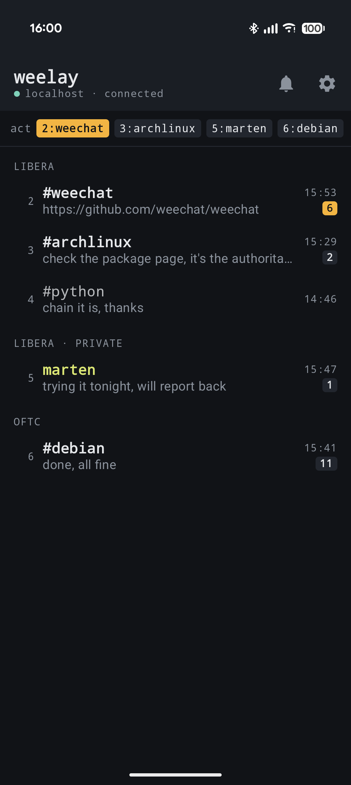
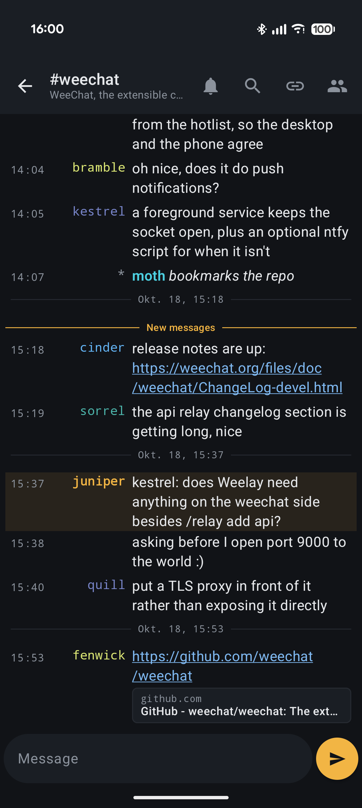
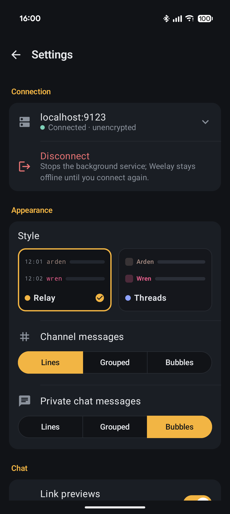
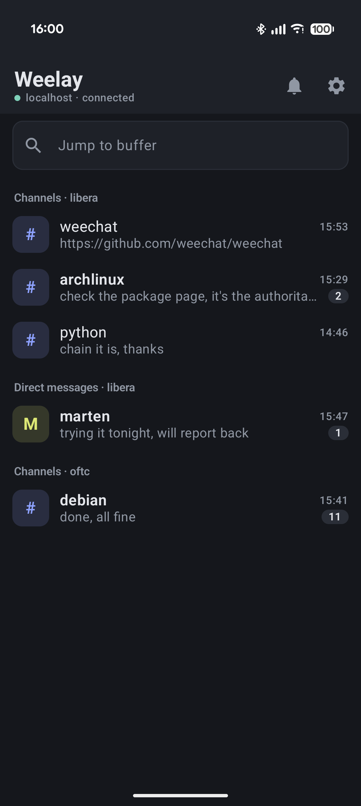
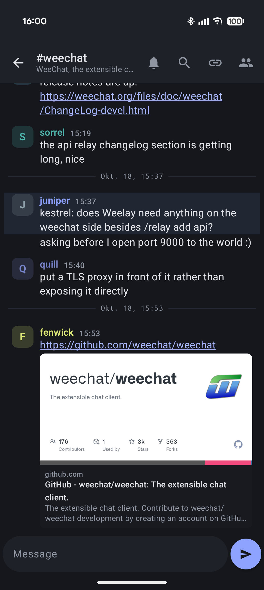
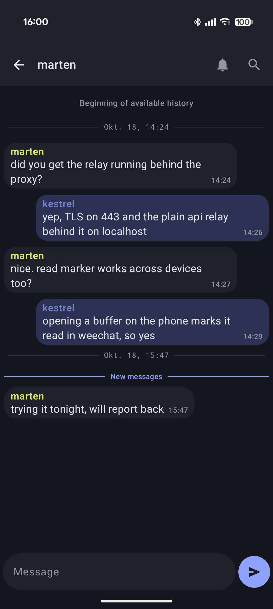

# Weelay

A modern Android client for [WeeChat](https://weechat.org/), built with Kotlin and Jetpack Compose.

Weelay talks to WeeChat over the **`relay api` protocol** — the JSON/WebSocket relay introduced in WeeChat 4.0 — not the legacy binary `relay weechat` protocol. It keeps WeeChat's way of doing things (buffer numbers, the hotlist, nick colours, IRC-style lines) and adds what a phone needs: notifications, a read marker, swipe gestures and link previews.

## Screenshots

<p align="center">
  
  
  
</p>
<p align="center">
  
  
  
</p>

## Features

- WeeChat `relay api` over WebSocket (`ws`/`wss`), password auth; self-signed relay
  certificates can be trusted by fingerprint
- Two styles, **Relay** (WeeChat-like, amber) and **Threads** (modern, periwinkle), and three
  message layouts — **Lines**, **Grouped** and **Bubbles** — chosen separately for channels and
  private chats
- Buffer list with WeeChat's buffer numbers, sections per network, a hotlist-style activity strip
  and (Threads) a jump-to-buffer filter
- Unread counts straight from WeeChat's hotlist, highlights marked separately; opening a buffer
  marks it read in WeeChat too, and a "new messages" divider shows where you left off
- Link detection, a per-buffer link list, and OpenGraph link previews (can be switched off)
- In-buffer search, channel topic, nicklist ranked by mode, input history
- Swipe to reply, swipe or long-press for nick actions (query, info, kick, ban, quiet); long-press
  a message to copy it, a buffer to mark it read or leave it
- Share text and links from other apps into a buffer
- Foreground service keeps the relay connected, reconnecting indefinitely with backoff and
  immediately when the device changes network
- High-importance notifications for highlights and private messages, with conversation history,
  inline reply, mark-as-read, and tap-to-open-the-buffer
- Optional companion WeeChat script (`weechat_ntfy_highlight.py`) that pushes highlights/DMs via
  [ntfy](https://ntfy.sh/) with deep links back into the app. By default it only pushes while no
  relay client is attached, so it covers the case the app can't (not running) without doubling up
  on notifications when it is

## Requirements

- Android 8.0 (API 26) or newer
- A WeeChat **4.0+** host with an `api` relay enabled:

  ```
  /relay add api 9000          # plaintext  →  use ws:// (SSL off in the app)
  /relay add tls.api 9000      # TLS         →  use wss:// (SSL on in the app)
  /set relay.network.password "your-relay-password"
  ```

  A common production setup is to run a plain `api` relay and put a TLS reverse proxy
  (nginx, Caddy, …) in front of it on port 443; in that case point the app at the proxy
  host:port with SSL **on**.

### Connecting

In the app's connect screen enter the relay **host**, **port**, **password**, and toggle
**SSL** to match your relay (`api` → off, `tls.api`/TLS proxy → on).

> Tip: if your host has both an A and AAAA DNS record but the relay only listens on IPv4,
> Android may prefer IPv6 and fail with `ECONNREFUSED`. Use the IPv4 literal, bind the relay
> to IPv6, or front it with a dual-stack reverse proxy.

## Building

```bash
./gradlew assembleDebug      # debug APK  → app/build/outputs/apk/debug/
./gradlew assembleRelease    # signed release APK (see Signing below)
./gradlew testDebugUnitTest  # run JVM unit tests
```

You need an Android SDK; point Gradle at it with a `local.properties` containing
`sdk.dir=/path/to/android-sdk` (this file is gitignored).

### Signing

Release builds are signed from a **gitignored** `keystore.properties` at the project root:

```properties
storeFile=/absolute/path/to/your-release.jks
storePassword=...
keyAlias=...
keyPassword=...
```

If `keystore.properties` is absent (e.g. a fresh clone or CI), the release build is produced
unsigned. The keystore itself lives outside the repo and must be backed up safely — losing it
means you can no longer ship updates under the same signature.

## Project layout

```
app/src/main/java/com/weelay/app/
├── relay/        # RelayClient (WebSocket + api protocol), message models, formatting
├── service/      # RelayService (foreground connection + notifications)
├── viewmodel/    # Chat / BufferList / Connect / Settings view models
├── ui/           # Compose screens and components
└── data/         # ConnectionPrefs (EncryptedSharedPreferences)
```

## Security notes

- Relay credentials are stored with `EncryptedSharedPreferences` (Android Keystore-backed).
- Nothing sensitive is committed: the signing keystore, `keystore.properties`, and
  `local.properties` are all gitignored.
- Use `wss`/TLS for any relay reachable over an untrusted network — `plain` auth over `ws://`
  sends the password in the (base64-encoded, unencrypted) handshake.

## License

Licensed under the **GNU General Public License v3.0** — see [LICENSE](LICENSE).
