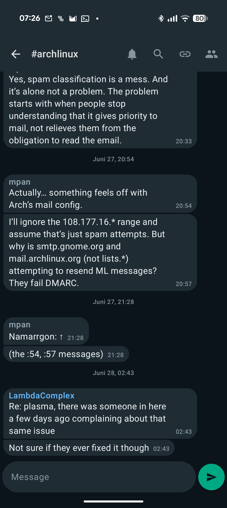
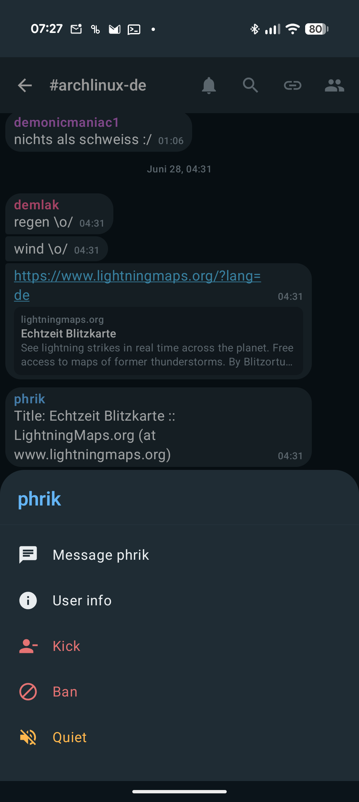
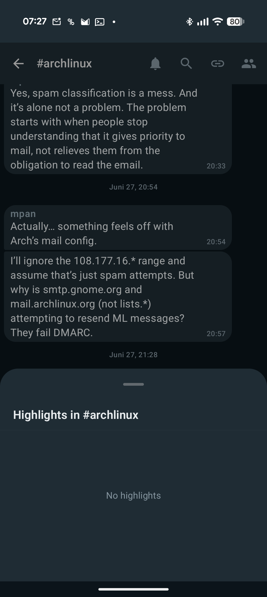

# Weelay

A modern Android client for [WeeChat](https://weechat.org/), built with Kotlin and Jetpack Compose.

Weelay talks to WeeChat over the **`relay api` protocol** — the JSON/WebSocket relay introduced in WeeChat 4.0 — not the legacy binary `relay weechat` protocol. It aims to be a fast, clean, chat-app-feel front end: grouped message bubbles, link previews, in-buffer search, swipe-to-reply, nick actions, highlight collection, and unread badges.

## Screenshots

<p align="center">
  
  
  
</p>

## Features

- WeeChat `relay api` over WebSocket (`ws`/`wss`), token auth
- Grouped, WhatsApp-style message bubbles with per-nick colors
- Link detection, a per-buffer link list, and rich OpenGraph link previews
- In-buffer search with match navigation
- Swipe to reply, swipe for nick actions (query, whois, ban, kick, quiet)
- Highlight collection (per-buffer and global)
- Unread badges per buffer; live connection-status banner
- Foreground service keeps the relay connected; high-importance notifications for highlights and private messages
- Optional companion WeeChat script (`weechat_ntfy_highlight.py`) that pushes highlights/DMs via [ntfy](https://ntfy.sh/) with deep links back into the app

## Requirements

- Android 8.0 (API 26) or newer
- A WeeChat **4.0+** host with an `api` relay enabled:

  ```
  /relay add api 9000          # plaintext  →  use ws:// (SSL off in the app)
  /relay add tls.api 9000      # TLS         →  use wss:// (SSL on in the app)
  /set relay.network.password "your-relay-password"
  ```

  A common production setup is to run a plain `api` relay and put a TLS reverse proxy
  (nginx, Caddy, …) in front of it on port 443; in that case point the app at the proxy
  host:port with SSL **on**.

### Connecting

In the app's connect screen enter the relay **host**, **port**, **password**, and toggle
**SSL** to match your relay (`api` → off, `tls.api`/TLS proxy → on).

> Tip: if your host has both an A and AAAA DNS record but the relay only listens on IPv4,
> Android may prefer IPv6 and fail with `ECONNREFUSED`. Use the IPv4 literal, bind the relay
> to IPv6, or front it with a dual-stack reverse proxy.

## Building

```bash
./gradlew assembleDebug      # debug APK  → app/build/outputs/apk/debug/
./gradlew assembleRelease    # signed release APK (see Signing below)
```

You need an Android SDK; point Gradle at it with a `local.properties` containing
`sdk.dir=/path/to/android-sdk` (this file is gitignored).

### Signing

Release builds are signed from a **gitignored** `keystore.properties` at the project root:

```properties
storeFile=/absolute/path/to/your-release.jks
storePassword=...
keyAlias=...
keyPassword=...
```

If `keystore.properties` is absent (e.g. a fresh clone or CI), the release build is produced
unsigned. The keystore itself lives outside the repo and must be backed up safely — losing it
means you can no longer ship updates under the same signature.

## Project layout

```
app/src/main/java/com/weelay/app/
├── relay/        # RelayClient (WebSocket + api protocol), message models, formatting
├── service/      # RelayService (foreground connection + notifications)
├── viewmodel/    # Chat / BufferList / Connect / Settings view models
├── ui/           # Compose screens and components
└── data/         # ConnectionPrefs (EncryptedSharedPreferences)
```

## Security notes

- Relay credentials are stored with `EncryptedSharedPreferences` (Android Keystore-backed).
- Nothing sensitive is committed: the signing keystore, `keystore.properties`, and
  `local.properties` are all gitignored.
- Use `wss`/TLS for any relay reachable over an untrusted network — `plain` auth over `ws://`
  sends the password in the (base64-encoded, unencrypted) handshake.

## License

Licensed under the **GNU General Public License v3.0** — see [LICENSE](LICENSE).
